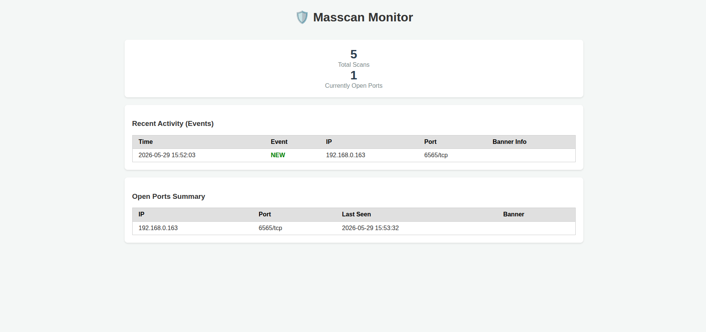
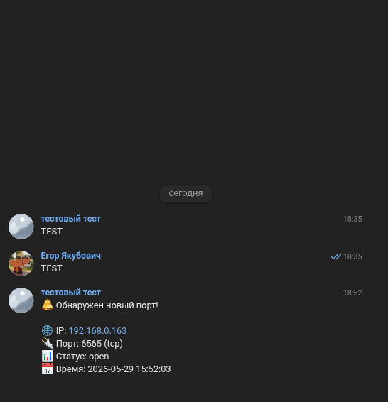

# Masscan Monitor

Автоматизированная система мониторинга сетевой инфраструктуры на базе Masscan. Программа предназначена для периодического сканирования заданных диапазонов IP-адресов, отслеживания изменений (новые порты, измененные баннеры) и оперативного уведомления владельца.

В силу особенностей работы с сетью и постановки задачи решено было реализовать сканнер как самостоятельную утилиту.

## Основной функционал

- Многопоточное сканирование: Высокая скорость работы благодаря интеграции с masscan.
- Умная дедупликация: Сохранение истории в SQLite и уведомление только о новых портах или измененных баннерах существующих сервисов.
- Real-time Дашборд: Веб-интерфейс на базе Go Chi + HTMX + SSE для мгновенного отображения событий без перезагрузки страницы. 
- Уведомления VK: Поддержка отправки алертов в ВКонтакте через API сообществ. 
- Гибкий планировщик: Индивидуальная настройка интервалов сканирования и таймаутов для каждой сети в отдельности.
- Безопасность: Доступ к дашборду по коду доступа (хэшированный пароль в конфигурации).

## Архитектура

Проект построен по модульному принципу с использованием асинхронного взаимодействия через Go-каналы:

1. **Scanner Service (Producer)**: Запускает процессы masscan в фоновом режиме, парсит JSON-вывод и отправляет "сырые" результаты в канал.
2. **Database Engine (Middleware)**: Получает пакеты результатов, выполняет сопоставление с текущим состоянием в SQLite. В случае обнаружения изменений (новый порт или новый баннер) генерирует события и сохраняет их в постоянный лог событий (event_log).
3. **Broadcaster (Tee)**: Распределяет поток событий между несколькими независимыми потребителями.
4. **Notifiers (Consumers)**: Асинхронные модули для VK, которые обрабатывают пакеты событий и выполняют внешние API-вызовы.
5. **Dashboard (Consumer + SSE)**: Веб-сервер, который не только отображает исторические данные, но и держит активные SSE-подключения (Server-Sent Events) с браузерами, мгновенно пробрасывая в них новые события из Broadcaster.

Такая архитектура позволяет системе выполнять тяжелые задачи сканирования, не блокируя работу веб-интерфейса и модулей уведомлений.

## Системные требования

- Go 1.25+ (для сборки)
- Masscan (должен быть установлен в системе)
- Права администратора (sudo) для выполнения сканирования.

## Быстрый старт

### 1. Настройка конфигурации
Отредактируйте файл `src/config.env`. Основные параметры:
- `SCAN_TARGETS`: Формат `имя:сеть:[порты]:интервал:таймаут`. Можно указывать несколько строк.
- `VK_TOKEN` / `VK_GROUP_ID`: Данные для уведомлений.
- `SERVER_PORT`: Порт дашборда (по умолчанию 8081).
- `DASHBOARD_ACCESS_HASH`: SHA-256 хэш кода доступа (по умолчанию 123456).

### 2. Сборка и запуск
Можно применить готовые бинарные файлы: scanner-*
Используйте Makefile для сборки:

```bash
# Сборка бинарного файла
make build

# Запуск программы напрямую через go run
make run
```

Или вручную:
```bash
go build -o scanner src/cmd/main.go
sudo ./scanner
```

## Тестирование

В проекте реализовано покрытие тестами основных модулей (сканер, база данных, планировщик, уведомления). Для запуска тестов используйте:

```bash
cd src
go test ./...
```

Для проверки покрытия:
```bash
go test -cover ./...
```

## Использование

1. Запустите программу. Она автоматически создаст базу данных `scanner.db` в текущей директории. Если запись в текущую директорию невозможна, будет использован fallback путь `/tmp/scanner.db`.
2. Откройте в браузере `http://localhost:8088`.
3. Введите код доступа (по умолчанию 123456, задается в конфигурации как SHA-256 хэш).
4. В разделе Recent Activity вы будете видеть новые события по мере завершения сканирований в реальном времени.

## Структура проекта

- `cmd/main.go` — точка входа, инициализация всех модулей и координация потоков данных.
- `internal/db/` — логика работы с SQLite, миграции, дедупликация и хранение событий.
- `internal/dashboard/` — веб-сервер, менеджер SSE-подключений и шаблоны HTMX.
- `internal/scanner/` — обертка над бинарным файлом Masscan и парсер результатов.
- `internal/vk/` — модуль уведомлений через API ВКонтакте.
- `internal/app/scheduler.go` — планировщик, управляющий воркерами сканирования.

## TO DO
- Анализ потенциальных уязвимостей
- Оповещение по email